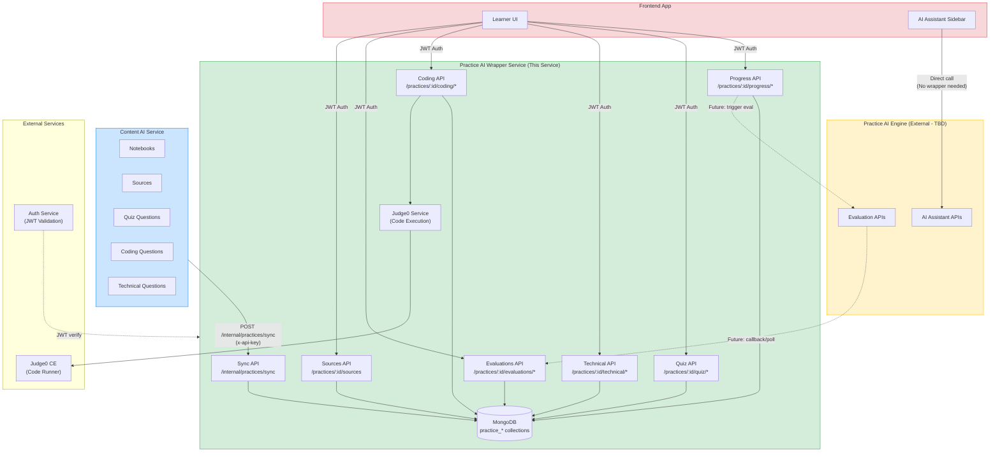
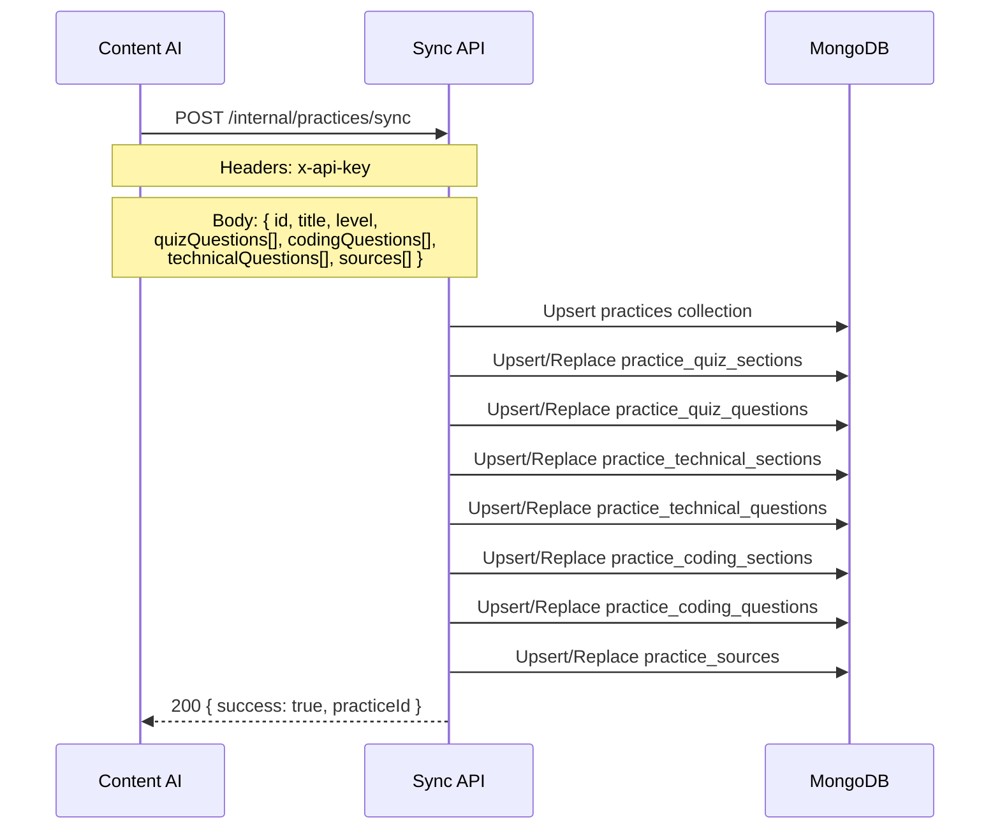
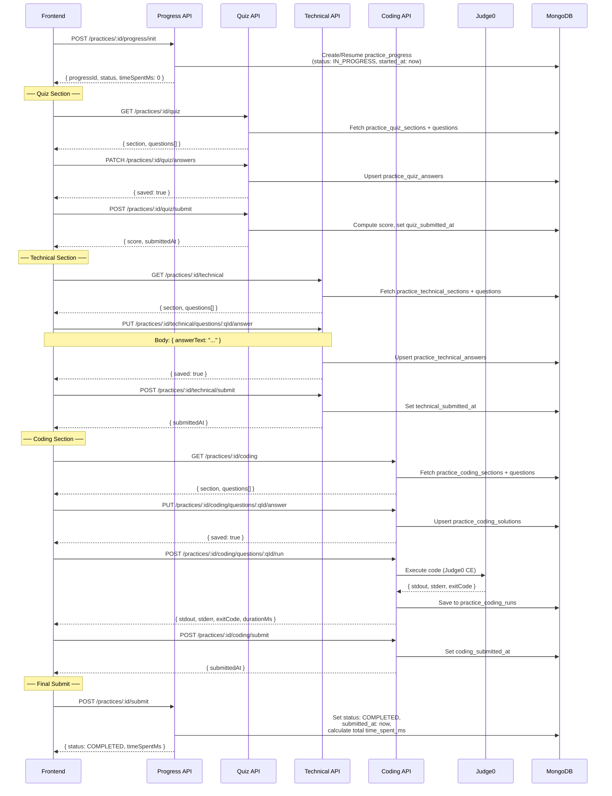
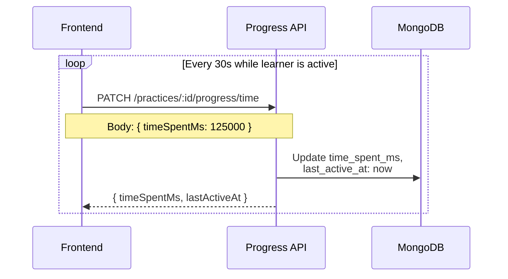
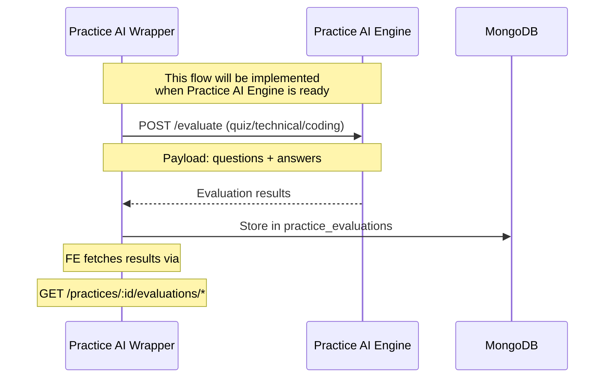
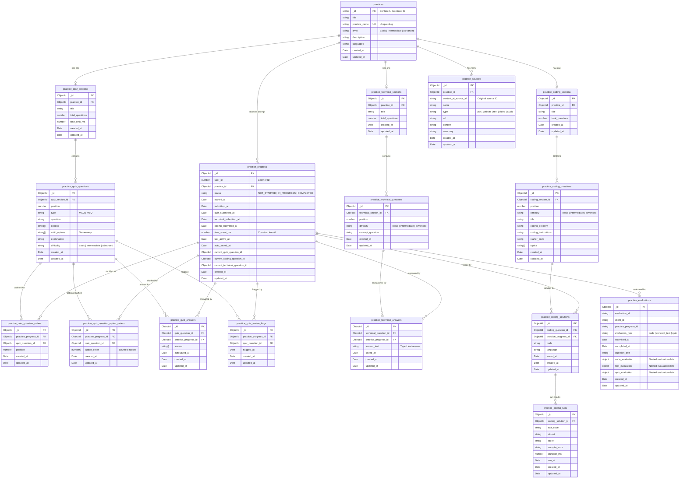
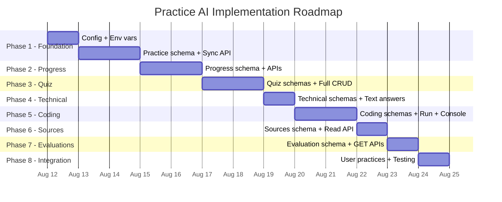

# Practice AI — Implementation Plan

Build the Practice AI module inside `EJET-ReviewAI-Wrapper-Services` with completely separate data storage, following the same DDD architecture as Review AI.

---

## System Architecture



---

## Data Flow Diagrams

### Flow 1: Practice Sync (Content AI → Practice AI)



### Flow 2: Learner Practice Attempt



### Flow 3: Time Tracking Heartbeat



### Flow 4: Future Evaluation Flow (TBD)



---

## ER Diagram



---

## Proposed Changes

### Component 1: Environment & Config

#### [MODIFY] [.env](file:///d:/BL_Project/EJET-ReviewAI-Wrapper-Services/.env)

```env
# Practice AI Engine (TBD - Engine not ready yet)
PRACTICE_AI_API_URL=http://localhost:5000/api/v1
PRACTICE_AI_API_KEY=practice-ai-engine-key
```

#### [NEW] `src/config/practice-ai.config.ts`

Register config namespace `practiceAi` with `apiUrl` and `apiKey`.

---

### Component 2: Folder Structure

```
src/practice-ai/
├── practice-ai.module.ts                  (root module)
│
├── practices/                              (sync + practice snapshot)
│   ├── domain/practice.ts
│   ├── dto/sync-practice.dto.ts
│   ├── infrastructure/persistence/document/
│   │   ├── entities/practice.schema.ts
│   │   ├── mappers/practice.mapper.ts
│   │   ├── repositories/practice-document.repository.ts
│   │   └── document-persistence.module.ts
│   ├── practices.controller.ts
│   ├── practices.service.ts
│   └── practices.module.ts
│
├── practice-progress/                      (progress + time tracking)
│   ├── domain/practice-progress.ts
│   ├── enums/practice-status.enum.ts
│   ├── infrastructure/persistence/document/
│   │   ├── entities/practice-progress.schema.ts
│   │   ├── mappers/practice-progress.mapper.ts
│   │   ├── repositories/practice-progress-document.repository.ts
│   │   └── document-persistence.module.ts
│   ├── practice-progress.controller.ts
│   ├── practice-progress.service.ts
│   └── practice-progress.module.ts
│
├── practice-quiz/                          (quiz section)
│   ├── domain/practice-quiz.ts
│   ├── infrastructure/persistence/document/
│   │   ├── entities/practice-quiz.schema.ts
│   │   ├── mappers/practice-quiz.mapper.ts
│   │   ├── repositories/practice-quiz-document.repository.ts
│   │   └── document-persistence.module.ts
│   ├── practice-quiz.controller.ts
│   ├── practice-quiz.service.ts
│   └── practice-quiz.module.ts
│
├── practice-technical/                     (technical - TEXT answers only)
│   ├── domain/practice-technical.ts
│   ├── infrastructure/persistence/document/
│   │   ├── entities/practice-technical.schema.ts
│   │   ├── mappers/practice-technical.mapper.ts
│   │   ├── repositories/practice-technical-document.repository.ts
│   │   └── document-persistence.module.ts
│   ├── practice-technical.controller.ts
│   ├── practice-technical.service.ts
│   └── practice-technical.module.ts
│
├── practice-coding/                        (coding - with FULL run + console)
│   ├── domain/practice-coding.ts
│   ├── infrastructure/persistence/document/
│   │   ├── entities/practice-coding.schema.ts
│   │   ├── mappers/practice-coding.mapper.ts
│   │   ├── repositories/practice-coding-document.repository.ts
│   │   └── document-persistence.module.ts
│   ├── practice-coding.controller.ts
│   ├── practice-coding.service.ts
│   └── practice-coding.module.ts
│
├── practice-evaluations/                   (read-only for now)
│   ├── domain/practice-evaluations.ts
│   ├── infrastructure/persistence/document/
│   │   ├── entities/practice-evaluation.schema.ts
│   │   ├── mappers/practice-evaluation.mapper.ts
│   │   ├── repositories/practice-evaluation-document.repository.ts
│   │   └── document-persistence.module.ts
│   ├── practice-evaluations.controller.ts
│   ├── practice-evaluations.service.ts
│   └── practice-evaluations.module.ts
│
└── practice-sources/                       (sources - synced from Content AI)
    ├── domain/practice-source.ts
    ├── infrastructure/persistence/document/
    │   ├── entities/practice-source.schema.ts
    │   ├── mappers/practice-source.mapper.ts
    │   ├── repositories/practice-source-document.repository.ts
    │   └── document-persistence.module.ts
    ├── practice-sources.controller.ts
    ├── practice-sources.service.ts
    └── practice-sources.module.ts
```

---

### Component 3: API Specifications

#### 3.1 Sync API (Internal — Content AI → Practice AI)

| Method | Endpoint | Guard | Description |
|---|---|---|---|
| `POST` | `/internal/practices/sync` | ApiKeyGuard | Upserts practice + all questions + sources |

#### 3.2 Practice Progress APIs

| Method | Endpoint | Guard | Description |
|---|---|---|---|
| `POST` | `/practices/:practiceId/progress/init` | JWT | Start or resume practice |
| `GET` | `/practices/:practiceId/progress/state` | JWT | Get progress, time spent, positions |
| `PATCH` | `/practices/:practiceId/progress/time` | JWT | Heartbeat: update `time_spent_ms` |
| `POST` | `/practices/:practiceId/submit` | JWT | Submit full practice (all sections) |
| `DELETE` | `/practices/:practiceId/delete-progress` | JWT | Clear all progress |
| `GET` | `/practices/:practiceId/submission-status` | Public | Check submission status |

#### 3.3 Quiz APIs

| Method | Endpoint | Guard | Description |
|---|---|---|---|
| `GET` | `/practices/:practiceId/quiz` | JWT | Fetch quiz section & questions |
| `GET` | `/practices/:practiceId/quiz/state` | JWT | Fetch saved answers, flags |
| `PATCH` | `/practices/:practiceId/quiz/answers` | JWT | Autosave one answer |
| `PATCH` | `/practices/:practiceId/quiz/review` | JWT | Toggle review flag |
| `POST` | `/practices/:practiceId/quiz/submit` | JWT | Submit & score quiz |

#### 3.4 Technical APIs (Text Answers)

| Method | Endpoint | Guard | Description |
|---|---|---|---|
| `GET` | `/practices/:practiceId/technical` | JWT | Fetch questions |
| `GET` | `/practices/:practiceId/technical/state` | JWT | Fetch saved text answers |
| `PUT` | `/practices/:practiceId/technical/questions/:questionId/answer` | JWT | Save text answer |
| `POST` | `/practices/:practiceId/technical/submit` | JWT | Submit technical section |

#### 3.5 Coding APIs (Full Run + Console)

| Method | Endpoint | Guard | Description |
|---|---|---|---|
| `GET` | `/practices/:practiceId/coding` | JWT | Fetch coding questions |
| `GET` | `/practices/:practiceId/coding/state` | JWT | Fetch saved code & runs |
| `PUT` | `/practices/:practiceId/coding/questions/:questionId/answer` | JWT | Save code |
| `POST` | `/practices/:practiceId/coding/questions/:questionId/run` | JWT | Run code (Judge0) |
| `POST` | `/practices/:practiceId/coding/submit` | JWT | Submit coding section |

#### 3.6 Evaluations APIs (Read-Only)

| Method | Endpoint | Guard | Description |
|---|---|---|---|
| `GET` | `/practices/:practiceId/evaluations` | JWT | All evaluation results |
| `GET` | `/practices/:practiceId/evaluations/quiz` | Public | Quiz evaluation |
| `GET` | `/practices/:practiceId/evaluations/technical` | Public | Technical evaluation |
| `GET` | `/practices/:practiceId/evaluations/coding` | Public | Coding evaluation |

#### 3.7 Sources & User History APIs

| Method | Endpoint | Guard | Description |
|---|---|---|---|
| `GET` | `/practices/:practiceId/sources` | JWT | Get all practice sources |
| `GET` | `/user-practices` | JWT | Get all practices for learner |

---

### Component 4: Shared Infrastructure (Reused, Not Duplicated)

| Component | Location | Used For |
|---|---|---|
| `Judge0Service` | `modules/coding/judge0.service.ts` | Code execution |
| `JwtAuthGuard` | `common/guards/jwt-auth.guard.ts` | JWT auth |
| `ApiKeyGuard` | `common/guards/api-key.guard.ts` | Sync API auth |
| `CurrentUser` | `common/decorators/current-user.decorator.ts` | Extract userId |
| `@Public()` | `common/decorators/public.decorator.ts` | Public endpoints |

---

## Implementation Phases



| Phase | What | Details |
|---|---|---|
| **Phase 1** | Foundation | Config, env vars, `practices` schema, `SyncPracticeDto`, sync controller/service |
| **Phase 2** | Progress | `practice_progress` schema, `PracticeStatus` enum, init/state/time/submit/delete APIs |
| **Phase 3** | Quiz | All 6 quiz collections, shuffle logic, answer CRUD, local scoring on submit |
| **Phase 4** | Technical | 3 technical collections, **text answer** save/read/submit (simplest section) |
| **Phase 5** | Coding | 4 coding collections, save code, **Judge0 run** integration, submit |
| **Phase 6** | Sources | `practice_sources` schema, synced during practice sync, GET read API |
| **Phase 7** | Evaluations | `practice_evaluations` schema, **GET-only** endpoints (no trigger) |
| **Phase 8** | Integration | `user-practices` listing API, end-to-end testing of full flow |

---

## Verification Plan

### Automated Tests
- `npm run build` — no compilation errors after each phase
- `npm run start:dev` — server starts clean

### Manual Verification
- Swagger docs (`/api/docs`) — test each endpoint
- MongoDB Compass — verify `practice_*` collections created separately from `review_*`
- Full flow test: sync → init → quiz answers → technical text → code run → submit
- Verify Judge0 code execution works through practice coding endpoints
