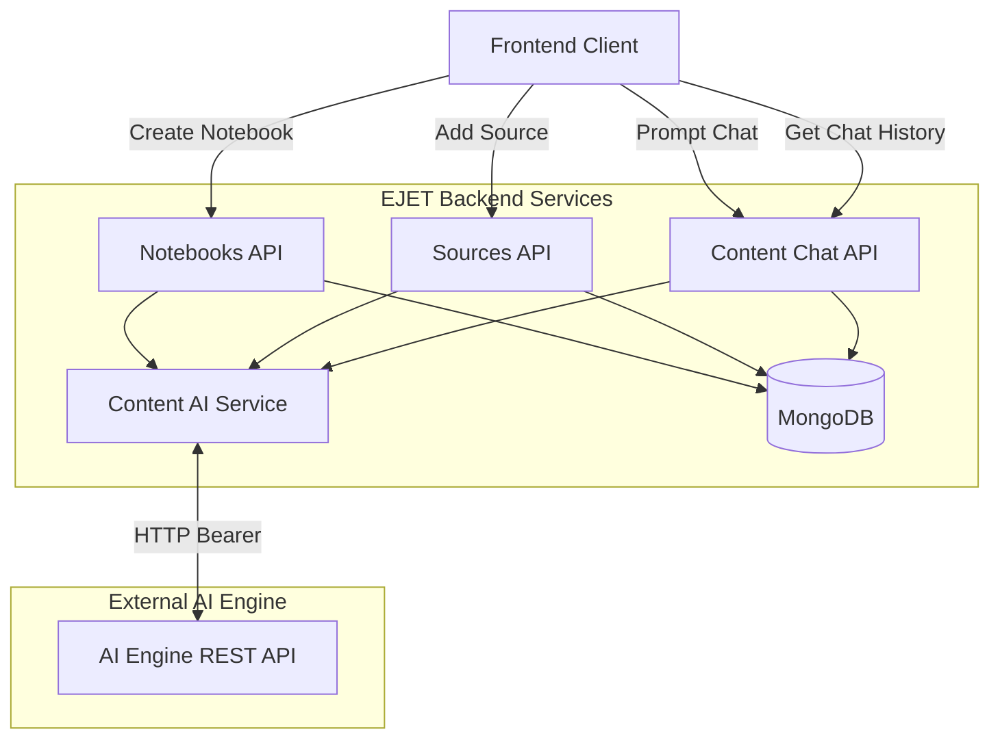
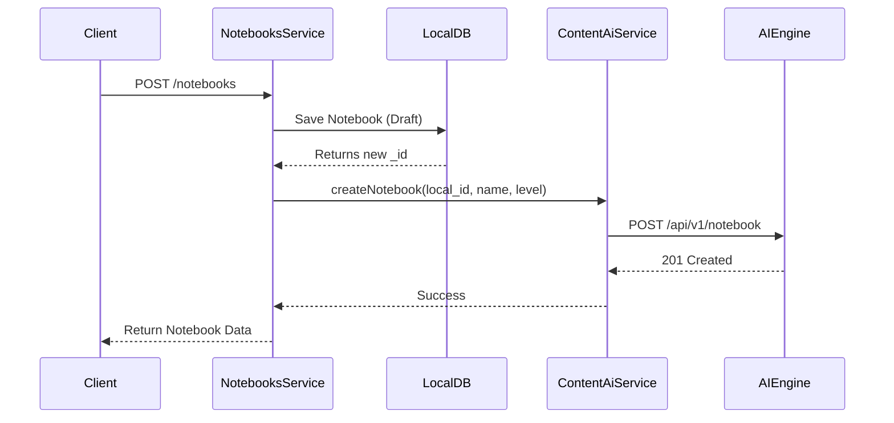
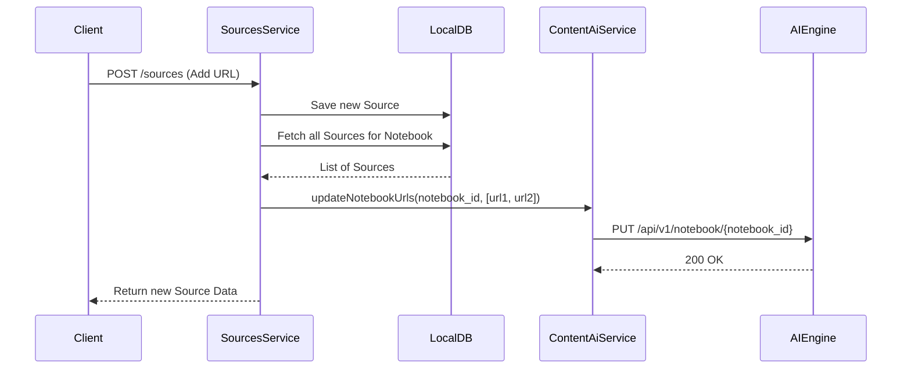
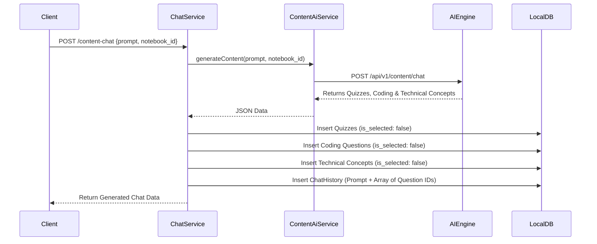
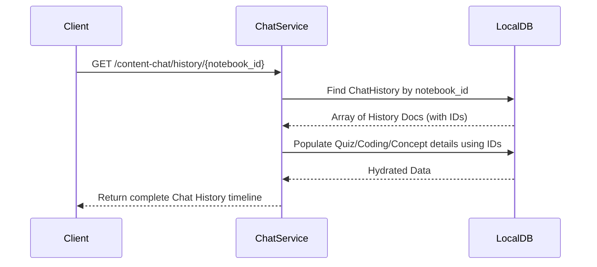

# Content AI Engine Integration Architecture & Implementation Plan

This document serves as the final, detailed plan for integrating the Content AI Engine into the EJET-ContentAI-Services backend. **All previous scenarios, diagrams, and schemas are retained below, supplemented with an exhaustive list of exactly which files and APIs will be modified or created.**

## 1. System Overview & Architecture

We are introducing a centralized integration layer (`ContentAiModule`) to interact with the external AI Engine. The local app will stay fully synchronized with the AI Engine for Notebooks and Sources. Furthermore, we are introducing a new `ContentChatModule` which will act as the bridge between the Frontend, the AI Engine, and our local question databases (Quizzes, Coding Problems, and Technical Concepts).

### Core Architecture Diagram


---

## 2. File and API Level Impact (Detailed Breakdown)

### A. Environment & Configuration
- **Affected Files:**
  - `.env` & `.env.example`: Add `CONTENT_AI_ENGINE_BASE_URL` and `CONTENT_AI_ENGINE_API_KEY`.
  - `src/config/app.config.ts` (or similar): Ensure these env vars are registered.
  - `src/config/content-ai.config.ts` **[NEW]**: Centralized config file for the AI Engine.

### B. Core Content AI Service Layer
- **New Files:**
  - `src/modules/content-ai/content-ai.module.ts` **[NEW]**
  - `src/modules/content-ai/content-ai.service.ts` **[NEW]**: Handles `fetch` requests to external AI.
- **APIs Affected:** None directly exposed to the frontend; this is an internal service consumed by other modules.

### C. Scenario A: Creating a Notebook
When a user creates a new notebook, we first construct the local database record. Once the local record is generated, we immediately call the AI Engine to register the notebook there.

- **Affected API:** `POST /notebooks` (Local Backend)
- **Affected Files:**
  - `src/modules/notebooks/notebooks.module.ts`: Import `ContentAiModule`.
  - `src/modules/notebooks/notebooks.service.ts`: Update the `create` method to invoke `ContentAiService.createNotebook`.
- **Logic:** If `ContentAiService.createNotebook` fails, the local transaction fails, and an error is thrown to the frontend.



### D. Scenario B: Adding a Source
When we add a source (e.g., website, video, pdf), we sync the updated list of URLs.

- **Affected API:** `POST /sources` (Local Backend)
- **Affected Files:**
  - `src/modules/sources/sources.module.ts`: Import `ContentAiModule`.
  - `src/modules/sources/sources.service.ts`: Update the `create` method to fetch all existing source URLs for the notebook, append the new one, and call `ContentAiService.updateNotebookUrls`.



### E. Scenario C: Chat Prompt (Generating Content)
When the user sends a prompt, we fetch the generated questions (quizzes, coding, technical concepts), store them as unselected items in our local DB, and save a chat history document pointing to them.

- **New APIs:** `POST /content-chat`
- **New Files:**
  - `src/modules/content-chat/content-chat.module.ts` **[NEW]**
  - `src/modules/content-chat/content-chat.controller.ts` **[NEW]**: Defines `POST /content-chat`.
  - `src/modules/content-chat/content-chat.service.ts` **[NEW]**: Handles logic to call AI Engine and parse response.
  - `src/modules/content-chat/infrastructure/persistence/document/entities/content-chat-history.schema.ts` **[NEW]**: MongoDB Schema.
  - `src/modules/content-chat/infrastructure/persistence/document/repositories/content-chat-history.repository.ts` **[NEW]**.
- **Logic:**
  1. Call AI Engine `POST /api/v1/content/chat`.
  2. Map AI Engine `results.quiz` to `QuizQuestionSchemaClass` (`is_selected: false`) and save via `QuizzesService`.
  3. Map AI Engine `results.coding_problems` to `CodingQuestionSchemaClass` (`is_selected: false`) and save via `CodingQuestionsService`.
  4. Map AI Engine `results.concept_questions` to `TechnicalConceptSchemaClass` (`is_selected: false`) and save via `TechnicalConceptsService`.
  5. Extract local Object IDs from saved questions.
  6. Save `content_chat_history` document.



### F. Scenario D: Fetching Chat History
When a user reopens an old notebook, they need to see their previous chat interactions. We will expose a `GET` API that retrieves the history documents and populates the question details.

- **New APIs:** `GET /content-chat/history/:notebook_id`
- **Affected Files:**
  - `src/modules/content-chat/content-chat.controller.ts`: Add `GET` route.
  - `src/modules/content-chat/content-chat.service.ts`: Add `getHistory` logic.
- **Logic:** Queries `content_chat_history` by `notebook_id`, sorts by `created_at` ASC, and uses Mongoose `.populate()` to fetch full `quiz_question_ids`, `coding_question_ids`, and `technical_concept_ids`.



---

## 3. Database Schema Updates

### Content Chat History Schema
We will create a new collection `content_chat_history` in MongoDB. For **every single prompt**, one document is created. 

```typescript
{
  _id: ObjectId,
  notebook_id: ObjectId, // Reference to Notebook
  session_id: String,
  prompt: String, // What the user asked
  
  // References to the questions generated from THIS specific prompt
  quiz_question_ids: [ObjectId], 
  coding_question_ids: [ObjectId],
  technical_concept_ids: [ObjectId],
  
  created_by: Number, // User ID (extracted from JWT via AuthGuard)
  created_at: Date,
  updated_at: Date
}
```

## 4. Final Review

This plan details the exact files and APIs that will be modified or created. We are ensuring that the Technical Concepts are parsed and saved just like Quizzes and Coding questions. The core logic handles the flow perfectly to match local IDs and external syncing.

Please approve this plan and we will move to execution!
