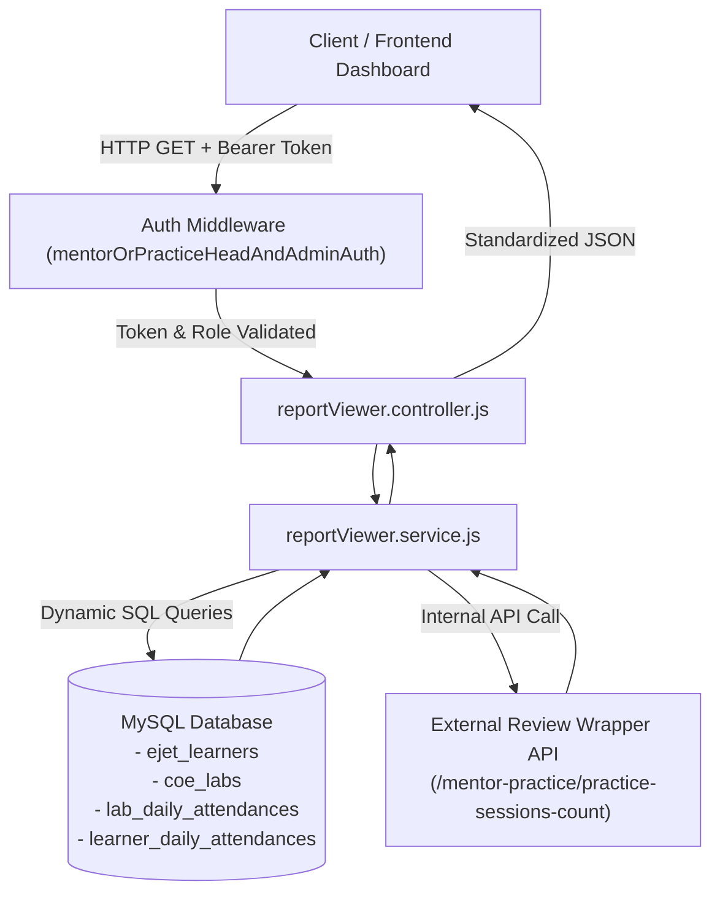
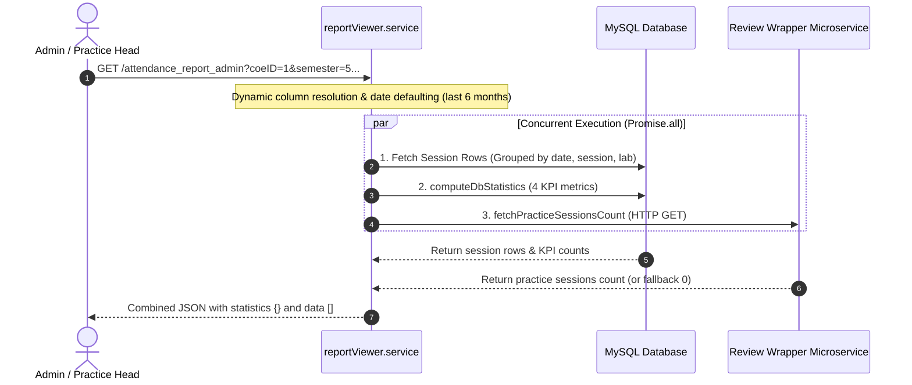
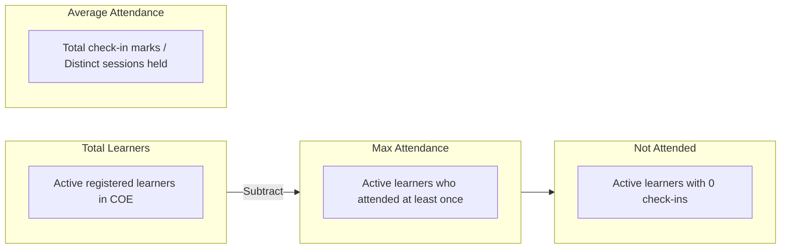
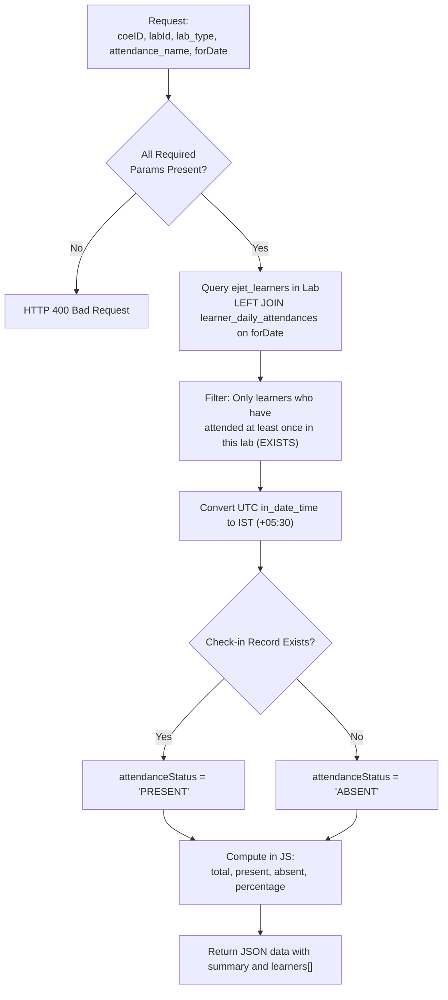
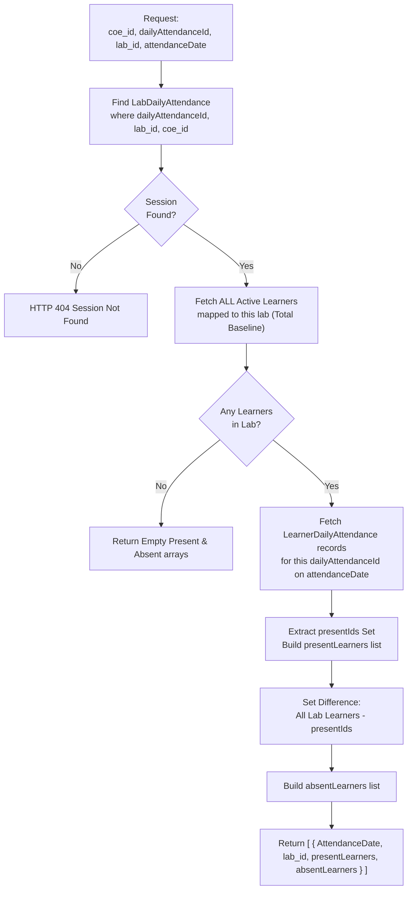
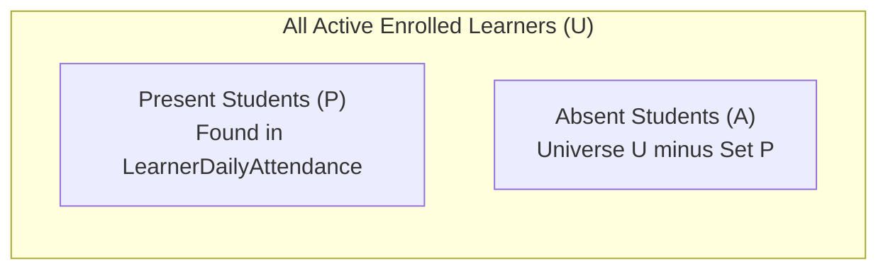
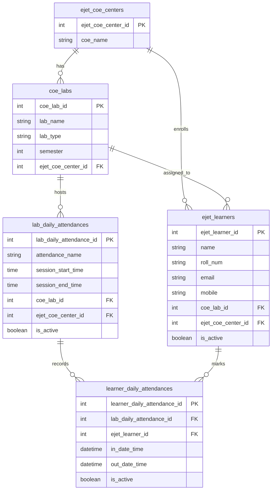

# Report Viewer APIs — Technical & Calculation Specification

This document provides a comprehensive, plain-language and architectural breakdown of the **3 APIs** exposed in the Report Viewer module (`src/routes/reportViewer.route.js`).

## 1. Overview & High-Level Architecture

The Report Viewer module is designed for **Center of Excellence (COE) Admins, Report Admins, Report Viewers, Super Admins, Practice Heads, and Mentors**. It transforms raw attendance punches into actionable analytics across multiple granularities:



### Route Base Path
All endpoints are mounted under:
```
GET /api/v1/reportViewer/...
```

### Access Control & Authorization
All 3 routes use the `mentorOrPracticeHeadAndAdminAuth` middleware. A valid JWT Bearer token must be included in the `Authorization` header. Permitted user roles:
- `super_admin`
- `coe_admin`
- `coe_report_admin`
- `coe_report_viewer`
- `mentor`
- `practice_head`

---

## 2. Shared Concepts & Dynamic Column Handling

### Dynamic Column Resolution (`getLabDailyAttendanceColumns`)
Across staging, dev, and production environments, column naming in `lab_daily_attendances` may slightly vary. The service runs a one-time schema check against `INFORMATION_SCHEMA.COLUMNS` to detect:
- **Lab ID Column**: checks for `coe_lab_id`, otherwise falls back to `lab_id`.
- **COE Center ID Column**: checks for `ejet_coe_center_id`, otherwise checks `coe_id`.

This ensures query compatibility without breaking production or local environments.

---

## 3. API 1: Attendance Report for Admin

### Purpose & Flow
- **Route**: `GET /api/v1/reportViewer/attendance_report_admin`
- **Controller**: `ReportController.getAttendanceReportForAdmin`
- **Service**: `ReportService.getAttendanceReportForAdmin`
- **Use Case**: Renders high-level COE dashboard KPI cards (total learners, practice sessions conducted, maximum learners attended, average attendance, not attended) and a tabular list of all lab attendance sessions conducted over a date range.



### Request Specification

#### Query Parameters
| Parameter | Type | Required? | Default | Description |
|---|---|---|---|---|
| `coeID` or `coe_id` | Integer / String | **Yes** | — | Center of Excellence ID |
| `semester` | Integer / String | No | All | Filter by student semester |
| `lab_type` | String | No | All | e.g., `Practice`, `Foundation`, `Tech` |
| `labName` | String | No | All | Specific lab name |
| `attendance_name`| String | No | All | e.g., `Morning Attendance` |
| `timeSlot` | String | No | All | Format: `"09:00:00 - 13:00:00"` |
| `fromDate` | Date (`YYYY-MM-DD`)| No | 6 months ago | Start date for session list |
| `toDate` | Date (`YYYY-MM-DD`)| No | Tomorrow | End date for session list |

---

### Step-by-Step Data Retrieval
When the request arrives:
1. **Date Window Defaulting**: If `fromDate` and `toDate` are omitted, `fromDate` defaults to 6 months prior, and `toDate` defaults to tomorrow.
2. **Parallel Fetch (`Promise.all`)**:
   - **DB Statistics** via `computeDbStatistics(coeID, semester, lab_type, cols)`
   - **Review Wrapper Sessions** via `fetchPracticeSessionsCount(coeID, semester, lab_type)`
   - **Detailed Session Table** via grouped SQL query on `lab_daily_attendances`

---

### Calculation Logic in Plain English

#### A. High-Level KPI Cards (`statistics` object)



1. **`totalLearners`**
   - *Plain English*: "How many active learners are enrolled in this COE (and semester/lab type if specified)?"
   - *Calculation*: Counts all distinct learners in table `ejet_learners` where `el.is_active = 1` and `el.ejet_coe_center_id = :coeID`.

2. **`practiceSessions`**
   - *Plain English*: "How many unique practice session assignments were actively attempted by students?"
   - *Calculation*: Sourced directly from the external `Review Wrapper` microservice. It counts distinct `practiceId`s that have learner progress records. If the external service fails or times out, it gracefully falls back to `0`.

3. **`maxAttendance`**
   - *Plain English*: "How many distinct active learners have shown up at least once across all sessions?"
   - *Calculation*: Takes the active learners from `ejet_learners` and checks if their ID exists in `learner_daily_attendances` for any active attendance session belonging to this center.

4. **`averageAttendance`**
   - *Plain English*: "On average, how many learners attend a session?"
   - *Formula*:
     $$\text{averageAttendance} = \frac{\text{Total Attendance Records Marked across all sessions}}{\text{Total Distinct Sessions Conducted (by Date and Session ID)}}$$
   - *Example*: If across 10 conducted sessions, a total of 850 check-ins were recorded, the average attendance is:
     $$\frac{850}{10} = 85.00$$

5. **`notAttended`**
   - *Plain English*: "How many active learners have NEVER attended even a single session?"
   - *Calculation*: Counts active learners who have zero entries in `learner_daily_attendances` within this center scope.
   - *Relationship*: Conceptually equals `totalLearners - maxAttendance`.

---

#### B. Tabular Session Rows (`data` array)
Each row represents a specific attendance session held on a specific date in a specific lab:

| Output Field | Calculation & Logic in Plain English |
|---|---|
| `AttendanceDate` | Formatted check-in date (`DD-Mon-YYYY`, e.g., `15-Oct-2026`). |
| `attendanceName` | Session title entered when creating the session (e.g. `Morning Attendance`). |
| `SessionTime` | Concatenation: `session_start_time + ' - ' + session_end_time`. |
| `lab_name`, `lab_type`, `semester` | Metadata from the lab table (`coe_labs`). |
| `TotalLearners` | Total active learners currently mapped to this lab (`COUNT(ejet_learners) WHERE coe_lab_id = labId AND is_active = 1`). |
| `MaxAttended` | Historical unique students in this lab who attended at least once historically. |
| `Attended` | **Learners present in this session**: Count of distinct learner IDs who marked attendance for this session. |
| `NotAttended` | **Learners absent from this session**: Calculated as `GREATEST(TotalLearners - Attended, 0)`. |
| `PercentageAttended` | $$\text{PercentageAttended} = \text{ROUND}\left(\frac{\text{Attended}}{\text{TotalLearners}} \times 100, 2\right)$$ If `TotalLearners` is 0, returns `null` or `0`. |

---

### Sample Response
```json
{
  "code": 200,
  "message": "Attendance report retrieved successfully",
  "statistics": {
    "totalLearners": 120,
    "practiceSessions": 18,
    "maxAttendance": 112,
    "averageAttendance": 88.45,
    "notAttended": 8
  },
  "data": [
    {
      "AttendanceDate": "28-Oct-2026",
      "attendanceName": "Morning Session",
      "SessionTime": "09:00:00 - 13:00:00",
      "coeId": 3,
      "labId": 12,
      "lab_name": "Web Development Lab A",
      "lab_type": "Practice",
      "semester": 5,
      "dailyAttendanceId": 104,
      "TotalLearners": 60,
      "MaxAttended": 58,
      "Attended": 54,
      "NotAttended": 6,
      "PercentageAttended": 90.00
    }
  ]
}
```

---

## 4. API 2: Lab-Wise Attendance Report

### Purpose & Flow
- **Route**: `GET /api/v1/reportViewer/lab_wise_attendance_report_admin`
- **Controller**: `ReportController.getLabWiseAttendanceReportForAdmin`
- **Service**: `ReportService.getLabWiseAttendanceReportForAdmin`
- **Use Case**: Detailed student roster for a specific lab on a specific calendar day. Lists every learner with their roll number, email, punch-in time in IST, and whether they were **PRESENT** or **ABSENT**.



### Request Specification

#### Query Parameters
| Parameter | Type | Required? | Description |
|---|---|---|---|
| `coeID` | Integer / String | **Yes** | Center of Excellence ID |
| `labId` | Integer | **Yes** | Unique identifier for the Lab |
| `lab_type` | String | **Yes** | e.g., `Practice` |
| `attendance_name`| String | **Yes** | Exact name of the session, e.g. `Morning Attendance` |
| `forDate` | Date String | **Yes** | Date of interest (e.g., `2026-10-28` or `28-Oct-2026`) |
| `timeSlot` | String | No | e.g., `"09:00 AM - 01:00 PM"` |

---

### Step-by-Step Data Retrieval
1. Validates mandatory parameters (`coeID`, `labId`, `lab_type`, `attendance_name`, `forDate`).
2. Normalizes `forDate` to `YYYY-MM-DD`.
3. Executes a raw SQL query that joins `ejet_learners` to `coe_labs` and `lab_daily_attendances`.
4. Performs a `LEFT JOIN` on `learner_daily_attendances` matching the target date and session.

---

### Calculation Logic in Plain English

#### 1. Candidate Learner Selection (Crucial Business Rule)
> [!IMPORTANT]
> This API includes **only active learners who have marked attendance at least once in this lab historically**.
> It enforces this using an SQL `EXISTS` clause:
> ```sql
> AND EXISTS (
>   SELECT 1 FROM learner_daily_attendances ever_lda
>   JOIN lab_daily_attendances ever_lbda ON ever_lda.lab_daily_attendance_id = ever_lbda.lab_daily_attendance_id
>   WHERE ever_lbda.coe_lab_id = lb.coe_lab_id
>     AND ever_lda.ejet_learner_id = l.ejet_learner_id
> )
> ```
> *Why?* Learners officially registered in the lab who have never once attended any session are intentionally excluded from this specific daily roster view.

#### 2. Determining `attendanceStatus`
- If `learner_daily_attendances` has a matching record for this learner on `forDate` -> **`'PRESENT'`**.
- If no record exists for this date -> **`'ABSENT'`**.

#### 3. Timezone Conversion (`inDateTime`)
- MySQL stores timestamps in UTC (`+00:00`).
- The query uses `CONVERT_TZ(leda.in_date_time, '+00:00', '+05:30')` to convert check-in times to Indian Standard Time (IST) and formats it as `DD-Mon-YYYY hh:mm AM/PM` (e.g., `28-Oct-2026 09:12 AM`).

#### 4. Summary Metrics (`data.summary`)
Computed in Node.js from the resulting learner rows:
- **`total`**: `rows.length` (all candidate learners in this lab).
- **`present`**: Count of rows where `attendanceStatus === 'PRESENT'`.
- **`absent`**: `total - present`.
- **`percentage`**:
  $$\text{percentage} = \text{Number}\left(\left(\frac{\text{present}}{\text{total}} \times 100\right).\text{toFixed}(2)\right)$$

---

### Sample Response
```json
{
  "code": 200,
  "message": "Attendance report retrieved successfully",
  "data": {
    "AttendanceDate": "28-Oct-2026",
    "lab_name": "Web Development Lab A",
    "attendanceName": "Morning Session",
    "summary": {
      "total": 50,
      "present": 45,
      "absent": 5,
      "percentage": 90.0
    },
    "learners": [
      {
        "AttendanceDate": "28-Oct-2026",
        "lab_name": "Web Development Lab A",
        "attendanceName": "Morning Session",
        "ejet_learner_id": 201,
        "learnerName": "Aarav Sharma",
        "roll_num": "2024-CSE-001",
        "learner_code": "BL001",
        "email": "aarav.sharma@example.com",
        "attendanceStatus": "PRESENT",
        "inDateTime": "28-Oct-2026 09:05 AM"
      },
      {
        "AttendanceDate": "28-Oct-2026",
        "lab_name": "Web Development Lab A",
        "attendanceName": "Morning Session",
        "ejet_learner_id": 202,
        "learnerName": "Bhavna Patel",
        "roll_num": "2024-CSE-002",
        "learner_code": "BL002",
        "email": "bhavna.patel@example.com",
        "attendanceStatus": "ABSENT",
        "inDateTime": null
      }
    ]
  }
}
```

---

## 5. API 3: Attendance Status Breakdown

### Purpose & Flow
- **Route**: `GET /api/v1/reportViewer/attendance-status`
- **Controller**: `ReportController.getAttendanceStatus`
- **Service**: `ReportService.getAttendanceStatus`
- **Use Case**: Returns attendance cleanly partitioned into **two distinct arrays**: `presentLearners[]` and `absentLearners[]` for a specific session ID (`dailyAttendanceId`). Ideal for dual-column UI screens or separate "Present" and "Absent" tabs.



### Request Specification

#### Query Parameters
| Parameter | Type | Required? | Description |
|---|---|---|---|
| `coe_id` | Integer / String | **Yes** | Center of Excellence ID |
| `dailyAttendanceId` | Integer | **Yes** | Primary key of `lab_daily_attendances` |
| `lab_id` | Integer | **Yes** | Lab identifier (`coe_lab_id`) |
| `attendanceDate` | String | **Yes** | Target date (`DD-MMM-YYYY` or `YYYY-MM-DD`) |

---

### Step-by-Step Data Retrieval
1. **Verify Session**: Searches `LabDailyAttendance` matching `{ dailyAttendanceId, lab_id, coe_id }` and fetches associated lab name. Returns 404 if not found.
2. **Fetch Baseline Students (`allLabLearners`)**:
   Retrieves **ALL active learners** mapped to this lab from the `Learners` table:
   ```javascript
   Learners.findAll({
     where: { coe_center_id: coe_id, lab_id, isActive: true }
   })
   ```
3. **Fetch Present Students (`presentLearners`)**:
   Retrieves all check-in entries from `LearnerDailyAttendance` for this session and date:
   ```javascript
   LearnerDailyAttendance.findAll({
     where: {
       dailyLabAttendance_id: dailyAttendanceId,
       is_active: true,
       DATE(in_date_time): formattedDate
     }
   })
   ```
4. **Identify IDs of Present Students**:
   Extracts `presentIds = presentLearners.map(pl => pl.learner.learner_id)`.

---

### Calculation Logic in Plain English

Unlike API 2 (which uses a raw SQL `LEFT JOIN` and excludes never-attended learners), API 3 uses **Set Theory in Node.js**:



1. **`presentLearners` List**:
   - *Plain English*: Any student who actually marked their attendance in this session on this date.
   - *Output fields*: `AttendanceName`, `ClassName` (Lab Name), `StudentRollNo`, `StudentName`, `StudentEmail`, `StudentPhone`, `Status: 'Present'`.

2. **`absentLearners` List**:
   - *Plain English*: Any active learner enrolled in this lab who did NOT check in to this session.
   - *Formula*:
     $$\text{absentLearners} = \{ \text{learner} \in \text{allLabLearners} \mid \text{learner.learner\_id} \notin \text{presentIds} \}$$
   - *Output fields*: `AttendanceName`, `ClassName`, `StudentRollNo`, `StudentName`, `StudentEmail`, `StudentPhone`, `Status: 'Absent'`.

---

### Sample Response
```json
{
  "code": 200,
  "message": "Attendance records retrieved successfully",
  "data": [
    {
      "AttendanceDate": "28-Oct-2026",
      "lab_id": "12",
      "presentLearners": [
        {
          "AttendanceName": "Morning Session",
          "ClassName": "Web Development Lab A",
          "StudentRollNo": "2024-CSE-001",
          "StudentName": "Aarav Sharma",
          "StudentEmail": "aarav.sharma@example.com",
          "StudentPhone": "9876543210",
          "Status": "Present"
        }
      ],
      "absentLearners": [
        {
          "AttendanceName": "Morning Session",
          "ClassName": "Web Development Lab A",
          "StudentRollNo": "2024-CSE-002",
          "StudentName": "Bhavna Patel",
          "StudentEmail": "bhavna.patel@example.com",
          "StudentPhone": "-",
          "Status": "Absent"
        }
      ]
    }
  ]
}
```

---

## 6. Key Differences & Comparison Matrix

| Feature / Aspect | API 1: `/attendance_report_admin` | API 2: `/lab_wise_attendance_report_admin` | API 3: `/attendance-status` |
|---|---|---|---|
| **View Level** | High-level aggregated summary & session history | Detailed student list for a single session | Categorized dual-array list (`present` vs `absent`) |
| **Primary Scope** | Whole COE (with optional lab/sem filters) | Single Lab + Single Session Name + Single Date | Single Attendance Session ID (`dailyAttendanceId`) |
| **Learner Baseline** | Active learners in COE (`ejet_learners.is_active = 1`) | Active learners in Lab **who attended at least once historically** (`EXISTS`) | **ALL** active learners currently assigned to the lab |
| **External Dependencies**| Yes: Calls **Review Wrapper** for `practiceSessions` | None (Direct MySQL) | None (Direct MySQL via Sequelize) |
| **Query Engine** | Raw SQL (`db.query`) with parallel `Promise.all` | Raw SQL (`db.query`) | Sequelize ORM (`findOne`, `findAll`) |
| **Time Format** | Date format `DD-Mon-YYYY` | Check-in time converted to **IST (`+05:30`)** | Date formatted as `DD-MMM-YYYY` |
| **Calculation Location** | In MySQL (`COUNT`, `ROUND`, `GREATEST`) | In MySQL (join) + summary counts in Node.js | In Node.js (in-memory set difference: `all - present`) |

> [!NOTE]
> **Why might Absent counts differ between API 2 and API 3?**
> - **API 2** filters out students who have never attended any session in that lab (`EXISTS (...)`). Thus, a ghost learner with 0 historical attendance won't appear as Absent.
> - **API 3** compares against the entire active roster of the lab (`isActive: true`). A ghost learner who never attended will be explicitly listed in `absentLearners`.

---

## 7. Database Schema & Entity Relationship

The diagram below displays the 5 database entities and their join keys used by the Report Viewer services:



