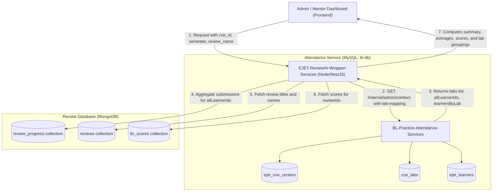
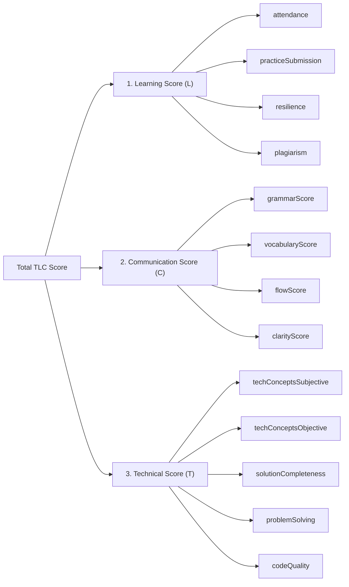

# Conducted Reviews Dashboard APIs – Detailed Technical & Business Documentation

This document explains the two APIs that power the **Conducted Reviews Dashboard**:
1. **API 1 (Macro / COE Level):** `GET /api/v1/mentor/report/conducted-reviews`
2. **API 2 (Micro / Lab Drill-down Level):** `GET /api/v1/mentor/report/conducted-reviews/:reviewId/lab-stats`

It describes **where the data comes from**, **how each field is calculated**, and **how the business logic works in simple**.

---

## 1. System Architecture & High-Level Data Flow

The dashboard combines data across two backend microservices and two distinct databases:



### The Two Services Involved:
1. **Attendance Service (`BL-Practice-Attendance-Services` — MySQL `bl-db`):**
   * Acts as the **source of truth for organization structure**: Centers of Excellence (COEs), Labs, Semesters, and enrolled active Learners.
2. **Review AI Wrapper Service (`EJET-ReviewAI-Wrapper-Services` — MongoDB):**
   * Acts as the **source of truth for review executions**: Review definitions, learner submission progress records, statuses, and TLC evaluation scores.

---

## 2. API 1: Macro View – Conducted Reviews Summary & List

### Endpoint Details
* **Route:** `GET /api/v1/mentor/report/conducted-reviews`
* **Access / Allowed Roles:** `super_admin`, `coe_admin`, `coe_report_admin`, `coe_report_viewer`
* **Controller / Service Code:** 
  * Controller: [`mentor.controller.ts`](file:///d:/BL_Project/EJET-ReviewAI-Wrapper-Services/src/modules/mentor/mentor.controller.ts#L183-L206)
  * Service: [`mentor.service.ts`](file:///d:/BL_Project/EJET-ReviewAI-Wrapper-Services/src/modules/mentor/mentor.service.ts#L1167-L1272)

### Query Parameters

| Parameter | Type | Required? | Default | Description |
| :--- | :--- | :--- | :--- | :--- |
| `coe_id` | Number | **Yes** | — | Unique identifier of the Center of Excellence (COE). |
| `semester` | Number / String | No | All | If supplied, scopes all data and baseline learners strictly to labs of this semester. |
| `review_name` | String | No | None | Case-insensitive search keyword to filter the conducted reviews by name. |

---

### Step-by-Step Execution Flow (How Data is Retrieved)

1. **Fetch COE Population Scope (Baseline Learners):**
   * The Review Wrapper calls the Attendance Service endpoint:
     `GET /api/v1/internal/admin/context-with-lab-mapping?coe_id=:coe_id&semester=:semester`
   * The Attendance Service finds all labs in that COE (`coe_labs WHERE ejet_coe_center_id = :coe_id`).
   * It retrieves all active learners mapped to those labs (`ejet_learners WHERE coe_lab_id IN (:labIds) AND is_active = 1`).
   * This array of learner IDs is returned as `allLearnerIds`.
   * **`totalLearnersInScope`** = `allLearnerIds.length`.

2. **Fetch Review Submissions (MongoDB Aggregation):**
   * Runs an aggregation pipeline on the `review_progress` collection matching records where:
     * `user_id` is in `allLearnerIds`
     * `submitted_at != null` (only actual submitted reviews are considered conducted)
   * Groups records by `review_id` and counts:
     * Distinct learners who submitted.
     * Total submission counts.
     * Count of `completed` reviews (`status` is `COMPLETED` or `TLC_PUBLISHED`).
     * Count of `inProgress` reviews (evaluating, verifying, or pending).

3. **Fetch Review Metadata & Scores:**
   * Fetches review display names and titles from MongoDB `reviews`.
   * Fetches all TLC evaluation scores for these reviews from MongoDB `tlc_scores`.
   * Calculates the **Total TLC Score** for each learner submission and groups them by `reviewId`.

4. **Apply Filters & Assemble Summary:**
   * If `review_name` was provided, filters the list of reviews.
   * Computes the global summary metrics across all visible conducted reviews.

---

### Sample Response

```json
{
  "summary": {
    "totalLearners": 11988,
    "totalLearnersGivenReview": 3450,
    "totalConductedReviews": 8,
    "totalReviews": 14210,
    "averageReviews": 1776.3,
    "averageScore": 71.45,
    "maxScore": 98.50,
    "maxReviews": 2350
  },
  "conductedReviews": [
    {
      "reviewId": "6ac47d3656e98f1ab7273b03",
      "reviewName": "Java_OOP_Sprint_1",
      "reviewTitle": "Object Oriented Programming Assessment",
      "reviewDate": "2025-01-15T09:00:00.000Z",
      "totalLearners": 11988,
      "totalLearnersGivenReview": 2100,
      "totalReviewsTaken": 2350,
      "avgScore": 73.80,
      "maxScore": 98.50,
      "completed": 2200,
      "inProgress": 150
    }
  ],
  "total": 8
}
```

---

### Field-by-Field Calculation Reference

#### Section A: The `summary` Object (Top Cards on Dashboard)

| Field Name | Data Source | Calculation & Plain English Meaning |
| :--- | :--- | :--- |
| **`totalLearners`** | Attendance Service (`allLearnerIds`) | **Total eligible learners in scope.**<br>Count of all active learners assigned to any lab in this COE (and within the selected semester, if filtered). Acts as the total target audience. |
| **`totalLearnersGivenReview`** | MongoDB `review_progress` | **Unique learners who participated.**<br>Count of distinct learners who submitted **at least one** of the conducted reviews displayed in the table. Even if a learner gave 5 different reviews, they are counted only **once** here. |
| **`totalConductedReviews`** | Processed Rows | **Total reviews conducted.**<br>Count of distinct reviews that have at least 1 submitted attempt from this COE's learners. |
| **`totalReviews`** | Sum of Rows | **Total submissions across all reviews.**<br>$$\sum \text{totalReviewsTaken}$$<br>Total count of all submitted review papers/attempts across all reviews. |
| **`averageReviews`** | Formula | **Average submissions per review topic.**<br>$$\text{averageReviews} = \frac{\text{totalReviews}}{\text{totalConductedReviews}}$$<br>Example: 14,210 total submissions across 8 reviews = $14,210 \div 8 = 1,776.3$ submissions per review. |
| **`averageScore`** | Formula | **Average score across all conducted reviews.**<br>Takes the `avgScore` of every conducted review that has scores ($> 0$), adds them up, and divides by the count of those reviews. Rounded to 2 decimal places. |
| **`maxScore`** | Highest Score | **Highest single score in the entire COE.**<br>The maximum individual score attained by any learner in any of the conducted reviews. |
| **`maxReviews`** | Maximum of Rows | **Peak review participation.**<br>The highest number of submissions that any single review received. |

---

#### Section B: The `conductedReviews[]` Array (Table Rows)

Each item in this array represents **one conducted review**:

| Field Name | Plain English Meaning & Calculation |
| :--- | :--- |
| **`reviewId`** | The unique MongoDB identifier for this review definition. Passed to API 2 when clicking a row. |
| **`reviewName`** | The internal code / short identifier assigned to the review (e.g. `Java_OOP_Sprint_1`). |
| **`reviewTitle`** | The user-friendly title of the review (e.g. `Object Oriented Programming Assessment`). |
| **`reviewDate`** | The date/timestamp when the review was created (`createdAt`). |
| **`totalLearners`** | Total eligible learners in this COE / semester (same as `summary.totalLearners`). Serves as the baseline denominator to calculate participation percentage for this review: $\text{Participation Rate} = \frac{\text{totalLearnersGivenReview}}{\text{totalLearners}} \times 100$. |
| **`totalLearnersGivenReview`** | **Unique learners who submitted this specific review.** If a student submitted this review twice (e.g. retake), they are counted only once here. |
| **`totalReviewsTaken`** | **Total submissions received for this review.** Counts every submitted record (`submitted_at != null`). |
| **`avgScore`** | **Average score achieved in this review.** Sum of all TLC scores received for this review divided by the count of graded submissions. Rounded to 2 decimal places. |
| **`maxScore`** | **Top score in this review.** The single highest TLC score achieved among all learners who took this review. |
| **`completed`** | Reviews that finished the entire grading pipeline. Review status is either `COMPLETED` or `TLC_PUBLISHED`. |
| **`inProgress`** | Reviews submitted by learners that are currently being processed (e.g. `EVALUATION_PENDING`, `LC_PENDING`, `VERIFICATION_PENDING`, or email notifications queued). |

---

## 3. API 2: Micro View – Lab-Wise Breakdown for a Specific Review

When an admin clicks on a specific review from the table in API 1, the dashboard calls this API to show **how each lab performed**.

### Endpoint Details
* **Route:** `GET /api/v1/mentor/report/conducted-reviews/:reviewId/lab-stats`
* **Access / Allowed Roles:** `super_admin`, `coe_admin`, `coe_report_admin`, `coe_report_viewer`
* **Controller / Service Code:** 
  * Controller: [`mentor.controller.ts`](file:///d:/BL_Project/EJET-ReviewAI-Wrapper-Services/src/modules/mentor/mentor.controller.ts#L210-L232)
  * Service: [`mentor.service.ts`](file:///d:/BL_Project/EJET-ReviewAI-Wrapper-Services/src/modules/mentor/mentor.service.ts#L1279-L1391)

### Parameters

| Parameter | Placement | Type | Required? | Description |
| :--- | :--- | :--- | :--- | :--- |
| `reviewId` | Path Param | String (24-hex) | **Yes** | The MongoDB `_id` of the review. |
| `coe_id` | Query Param | Number | **Yes** | The Center of Excellence (COE) ID. |
| `semester` | Query Param | Number / String | No | Optional semester filter. |

---

### Step-by-Step Execution Flow (How Data is Retrieved)

1. **Map Learners to Labs:**
   * Calls Attendance Service `context-with-lab-mapping`.
   * Attendance Service returns:
     * `labs`: Array of labs with `id`, `name`, `lab_type`, `semester`.
     * `learnersByLab`: Mapping of `{ [labId]: [learnerId1, learnerId2, ...] }`.
     * `allLearnerIds`: Flat array of all learners.
   * Review AI builds an inverted lookup map: `learnerToLab: Map<learnerId, labId>`.

2. **Fetch Review Progress for this Review:**
   * Queries MongoDB `review_progress` for all records where:
     * `review_id` = `reviewId`
     * `user_id` is in `allLearnerIds`

3. **Fetch TLC Scores:**
   * Queries `tlc_scores` for this `reviewId` and the matched learners.
   * Maps each score to the learner ID.

4. **Bucket by Lab:**
   * Iterates through every progress record:
     * Looks up which `labId` the student belongs to using `learnerToLab`.
     * Adds the student ID to `labStatsMap[labId].totalLearners` (a `Set` to ensure uniqueness).
     * If `submittedAt` is not null: increments `totalReviews` and pushes their TLC score into `scores[]`.
     * If status is `COMPLETED` or `TLC_PUBLISHED`: increments `completed`.
     * If status is intermediate: increments `inProgress`.

5. **Format & Filter:**
   * Calculates `avgScore` and `maxScore` per lab.
   * Filters out labs with **0 participating learners** (`totalLearners > 0`).

---

### Sample Response

```json
{
  "reviewId": "6ac47d3656e98f1ab7273b03",
  "reviewName": "Java_OOP_Sprint_1",
  "reviewTitle": "Object Oriented Programming Assessment",
  "labs": [
    {
      "labId": 12,
      "labName": "CSE-Lab-A",
      "totalLearners": 65,
      "totalReviews": 65,
      "avgScore": 78.40,
      "maxScore": 96.00,
      "completed": 62,
      "inProgress": 3
    },
    {
      "labId": 14,
      "labName": "CSE-Lab-B",
      "totalLearners": 58,
      "totalReviews": 60,
      "avgScore": 71.20,
      "maxScore": 92.50,
      "completed": 58,
      "inProgress": 2
    }
  ]
}
```

---

### Field-by-Field Calculation Reference

| Field Name | Data Source | Calculation & Plain English Meaning |
| :--- | :--- | :--- |
| **`reviewId`** | Path / Review Record | The unique ID of the review being inspected. |
| **`reviewName`** | Review Record | Short identifier of the review. |
| **`reviewTitle`** | Review Record | Display title of the review. |
| **`labId`** | MySQL `coe_labs` | Unique database identifier of the lab. |
| **`labName`** | MySQL `coe_labs` | Human-readable name of the lab (e.g. `CSE-Lab-A`). |
| **`totalLearners`** | Set of `p.userId` | **Distinct learners from this lab who participated in this review.**<br>Count of unique learners assigned to this lab who initiated or submitted this specific review. |
| **`totalReviews`** | Count | **Total submissions from this lab.**<br>Total count of submitted review records (`submitted_at != null`) originating from learners of this lab. |
| **`avgScore`** | Formula | **Lab Average Score.**<br>$$\text{avgScore} = \frac{\sum \text{TLC Scores in Lab}}{\text{Count of Graded Submissions in Lab}}$$<br>Average score obtained by learners in this lab. Rounded to 2 decimal places. |
| **`maxScore`** | Maximum | **Highest Score in Lab.**<br>Highest TLC score scored by any learner in this specific lab. |
| **`completed`** | Count | Number of reviews in this lab that have completed grading (`COMPLETED` or `TLC_PUBLISHED`). |
| **`inProgress`** | Count | Number of reviews in this lab that have been submitted and are currently awaiting AI evaluation, mentor verification, or publication. |

> [!NOTE]
> Labs that had **zero** participating learners for this review are omitted from the `labs[]` list to keep the dashboard focused on active participants.

---

## 4. How the TLC Score is Calculated

The review system grades submissions using the **TLC framework** (Thinking & Learning, Communication, Technical).
In code, this is calculated by [`computeTlcTotal(score)`](file:///d:/BL_Project/EJET-ReviewAI-Wrapper-Services/src/modules/mentor/mentor.service.ts#L1395-L1414):

$$\text{Total TLC Score} = \text{Learning Score} + \text{Communication Score} + \text{Technical Score}$$

### Breakdown of the 3 Components:



1. **Learning Score (L):**
   $$\text{Learning} = \text{attendance} + \text{practiceSubmission} + \text{resilience} + \text{plagiarism}$$
2. **Communication Score (C):**
   * If evaluated by the modern communication evaluator:
     $$\text{Communication} = \text{grammarScore} + \text{vocabularyScore} + \text{flowScore} + \text{clarityScore}$$
   * If legacy format:
     $$\text{Communication} = \text{comprehension} + \text{verbalCommunication} + \text{writtenCommunication}$$
3. **Technical Score (T):**
   $$\text{Technical} = \text{techConceptsSubjective} + \text{techConceptsObjective} + \text{solutionCompleteness} + \text{problemSolving} + \text{codeQuality}$$

The sum of all three components yields the final score out of 100 used in `avgScore` and `maxScore`.

---

## 5. Important Business Rules & Edge Cases

### 1. What qualifies a review as "Conducted"?
* A review is **only** considered "conducted" if **at least one learner in that COE has submitted it** (`submitted_at != null`).
* Draft reviews or reviews assigned but not yet submitted by any learner are excluded from both APIs.

### 2. How the `semester` Filter Operates
* If the user selects a semester (e.g. `semester=3`):
  * The Attendance Service filters labs to `WHERE semester = 3`.
  * `allLearnerIds` only contains learners enrolled in Semester 3 labs.
  * All metrics (`totalLearners`, submissions, average scores) dynamically recalculate exclusively for Semester 3.

### 3. How the `review_name` Filter Operates (API 1)
* Matches any review whose `reviewName` contains the search keyword (case-insensitive).
* **Important:** When filtered by `review_name`, the summary field `totalLearnersGivenReview` re-queries MongoDB so that it reflects only learners who submitted the reviews matching that specific name.

### 4. Why `totalLearners` May Differ from `GET /api/v1/coe`
* `GET /api/v1/coe` counts **all active learners registered under the COE center** (`ejet_coe_center_id = :id AND is_active = 1`), regardless of whether they have been assigned to a lab.
* The Conducted Reviews APIs query learners **via labs** (`coe_lab_id IN (:labIds)`). Any learner with `coe_lab_id = NULL` (unallocated / not assigned to a lab) is excluded from the review scope since reviews and attendances are tracked through labs.

---

## 6. Quick Reference Summary Table for Frontend Integration

| Dashboard Component | API Used | JSON Property | Key Calculation / Behavior |
| :--- | :--- | :--- | :--- |
| **Total COE Learners Card** | API 1 | `summary.totalLearners` | Count of active learners enrolled in labs of this COE. |
| **Learners Evaluated Card** | API 1 | `summary.totalLearnersGivenReview` | Distinct count of students who submitted $\ge 1$ review. |
| **Total Reviews Conducted Card** | API 1 | `summary.totalConductedReviews` | Number of distinct review assessments held. |
| **Total Submissions Card** | API 1 | `summary.totalReviews` | Grand total of review papers submitted. |
| **Overall Average Score Card** | API 1 | `summary.averageScore` | Mean average of all conducted review average scores. |
| **COE Top Score Card** | API 1 | `summary.maxScore` | Highest individual score attained across all reviews. |
| **Review List Table** | API 1 | `conductedReviews[]` | List of reviews with participation, submissions, and scores. |
| **Lab Breakdown Drawer/Modal** | API 2 | `labs[]` | Per-lab stats: participation, submissions, avg score, max score. |
